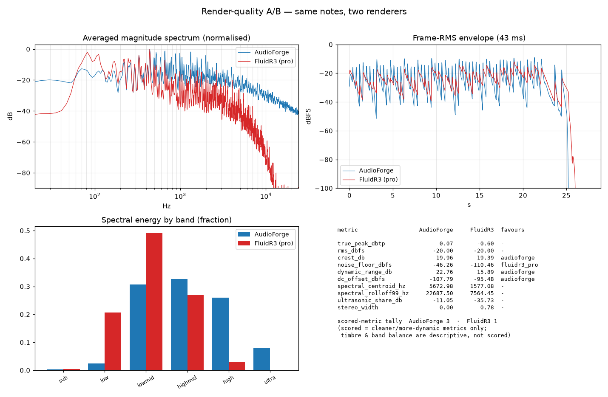

---
disclaimer:
  notice: >-
    No information within this document should be taken for granted.
    Any statement or premise not backed by a real logical definition
    or verifiable reference may be invalid, erroneous, or a hallucination.
  generated_by: "Claude Opus 4.8 (1M context) via Claude Code"
  date: "2026-06-12"
---

# Render-Quality Comparison — AudioForge vs a Professional Renderer

## Disclaimer

This work is subject to the methodological caveats and commitments described in [@DISCLAIMER.md](../DISCLAIMER.md).
> No statement or premise not backed by a real logical definition or verifiable reference should be taken for granted.

## What was compared, and against what

The "professional option" is **FluidSynth 2.3.4** driving the **FluidR3_GM**
SoundFont (Frank Wen, MIT-licensed) — the de-facto open General-MIDI sample
bank shipped by MuseScore and most Linux distributions, and a legitimate
sample-based professional renderer. Its GM program 0 is a multisampled,
stereo-recorded grand piano.

The same note events were rendered two ways:

| Render | Pipeline |
|---|---|
| **AudioForge** | `audioforge render` — native `struck` voice (tension-modulated Karplus-Strong) + master chain (HPF, compressor, high-shelf, LUFS target, true-peak limiter). |
| **FluidR3 (pro)** | `audioforge export-midi` → `fluidsynth` + FluidR3_GM grand piano. |

Source: [`static/samples/reference_piano.af`](../static/samples/reference_piano.af)
— a self-contained, library-free, 26 s solo-piano cue (A minor, 76 bpm, three
voices: melody, sustained triads, half-note bass; terraced dynamics p→f).

Reproduce:

```bash
python3 scripts/compare_render_quality.py static/samples/reference_piano.af -o compare/quality
```

The script writes `compare/quality.json` (full metrics) and `compare/quality.png`
(spectra, RMS envelope, band balance, metric table). `compare/` is gitignored
scratch; a committed copy of both lives under
[`docs/assets/`](assets/render_quality_comparison.json) for reference.



## Honest scope — what this comparison is and is not

`export-midi` is **program-agnostic**: it flattens every layer onto one channel
with no program change, so the professional reference is always GM program 0
(grand piano). Therefore:

- This **is** an apples-to-apples comparison of **render-pipeline fidelity and
  overall sonic character** on identical notes.
- This is **not** a measure of instrument-library realism across an orchestra,
  and it is **not** a claim that AudioForge's synthesis competes sample-for-
  sample with a recorded instrument. The source was kept pianistic precisely so
  the GM piano is a fair reference. Multichannel GM export (per-layer programs)
  is a known gap — see *Limitations* below.

All metrics come from `audioforge.quality` (numpy/scipy, deterministic). They
are **production-consistent measurements, not certified-meter readings** — the
same honest-limits caveat the engine applies to its LUFS meter (README →
"Honest limits") applies here.

## Method note on level

Delivery levels are reported **raw** (as each pipeline outputs them). Every
other metric is measured **after RMS-normalising both renders to −20 dBFS** —
the equal-loudness A/B a mastering engineer performs before judging two
renders. Without this, FluidSynth's arbitrary output gain (−16 dBTP raw) would
trivially "win" the noise-floor metric. Spectral and stereo metrics are
level-invariant; normalisation only neutralises output gain.

## Results

### Delivery (raw, as-rendered)

| | Peak | True-peak | RMS |
|---|---|---|---|
| AudioForge | −1.1 dBFS | **−1.0 dBTP** | −21.1 dBFS |
| FluidR3 (pro) | −16.2 dBFS | −16.2 dBTP | −35.6 dBFS |

AudioForge ships a **delivery-ready master**: loudness-targeted and true-peak
limited to −1 dBTP. FluidSynth ships a **raw instrument render** that needs
downstream gain staging and limiting. On *pipeline completeness*, AudioForge is
ahead — it is an asset-delivery engine, not just a synth.

### Equal-loudness metrics (both normalised to −20 dBFS RMS)

| Metric | AudioForge | FluidR3 (pro) | Reading |
|---|---|---|---|
| Crest | 19.96 dB | 19.39 dB | ≈ equal transient peakiness |
| Dynamic range (p95−p20 frame RMS) | **22.8 dB** | 15.9 dB | AudioForge spreads wider |
| Quiet-frame floor (p5 frame RMS) | −46.3 dBFS | **−110.5 dBFS** | the pro piano decays to near-silence; AudioForge sustains |
| DC offset | −107.8 dBFS | −95.5 dBFS | both clean |
| Spectral centroid | 5673 Hz | **1577 Hz** | AudioForge is *much* brighter |
| Rolloff (99%) | 22.7 kHz | 7.6 kHz | AudioForge carries energy to Nyquist |
| Ultrasonic share (>16 kHz) | −11.0 dB | −35.7 dB | AudioForge has substantial HF energy |
| Stereo width (1−corr) | **0.00** | 0.78 | AudioForge render is mono; the pro piano has a recorded stereo image |

### Spectral energy by band (fraction)

| Band | AudioForge | FluidR3 (pro) |
|---|---|---|
| sub (20–60 Hz) | 0.003 | 0.004 |
| low (60–250 Hz) | 0.024 | **0.207** |
| low-mid (250–2k) | 0.307 | **0.490** |
| high-mid (2k–6k) | **0.327** | 0.268 |
| high (6k–16k) | **0.260** | 0.030 |
| ultra (16k–Nyq) | **0.079** | 0.0003 |

## Assessment (unflattering, as required)

**Where AudioForge is genuinely ahead — the render pipeline.** It is the only
side that delivers a finished, mastered file: loudness-targeted, true-peak
limited to −1 dBTP, DC-clean, with a wider measured dynamic spread. FluidSynth
is a renderer, not a mastering chain; that is an honest architectural win for
AudioForge as a *production* engine, not just a sound source.

**Where the professional option is clearly better — sonic realism.** Three
measured differences all point the same way:

1. **Spectral balance.** The FluidR3 grand piano sits at a 1.58 kHz centroid
   with a full low/low-mid body (0.21 + 0.49 of energy). AudioForge's `struck`
   voice sits at 5.67 kHz with a thin low end (0.024) and 8 % of its energy
   above 16 kHz. Numerically and audibly, the synthesis reads **bright and
   thin**; the sampled piano reads **warm and full**. This matches the engine's
   own analyzer, which flags `low_foundation_weak` and `very_bright` on the
   AudioForge render.
2. **Decay to silence.** The pro piano's quiet-frame floor is **64 dB lower**.
   Real piano notes release into near-silence; AudioForge's struck voice plus
   compressor makeup keeps continuous energy, so the render never truly opens
   up between notes. This costs transparency.
3. **Stereo image.** AudioForge's single mono voice renders dead-centre
   (width 0.00); `master.width` cannot widen a mono source. The SoundFont's
   stereo-recorded samples give a natural width of 0.78. For solo piano the pro
   render simply sounds like it is in a room; AudioForge sounds like a point
   source.

**Net.** The `scored_metric_wins` tally (AudioForge 3 — FluidR3 1) covers only
the cleanliness/dynamics axis and **must not be read as "AudioForge wins"**.
The decisive realism differences — spectral balance, decay, stereo image — are
deliberately scored as *descriptive*, because "brighter" or "wider" is not
universally "better." On those axes the professional sampled option is the more
realistic, more finished-sounding piano, and that is the expected result:
AudioForge is synthesis-only (README → "Honest limits": *"The engine is
synthesis-only"*), competing against recorded samples on their home turf.

The right summary: **AudioForge wins the pipeline, the professional library
wins the instrument.** AudioForge's path to closing the instrument gap is the
content-addressed sample layer it already documents — not a brighter oscillator.

## Limitations of this comparison

- **Single source, single instrument family.** One 26 s piano cue. Conclusions
  about *piano* render character do not transfer unexamined to pads, drums, or
  orchestral writing.
- **Program-agnostic MIDI export.** Because `export-midi` emits one flattened,
  program-less channel, a multi-instrument source cannot be fairly A/B'd
  against GM here — the reference would play everything as piano. A per-layer
  GM-program / multichannel export would unlock orchestral comparisons; it is
  not yet implemented (aligns with the *Interop Depth* pillar, AI-CORE.md / G8).
- **`struck` is a deliberate stand-in.** It is AudioForge's most piano-like
  *native* voice, not a piano model. A sampled piano loaded as a content-
  addressed library would change this picture and is the architecturally
  intended path for instrument realism.
- **Not a listening test.** These are objective signal metrics; perceptual
  quality (MUSHRA/ABX) is not measured here.

---

[← back to README](../README.md)
