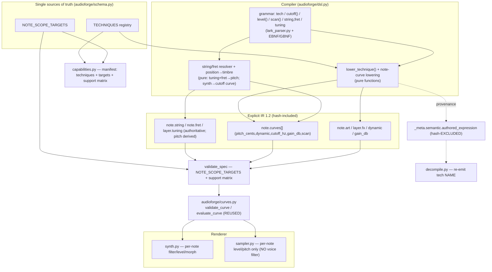
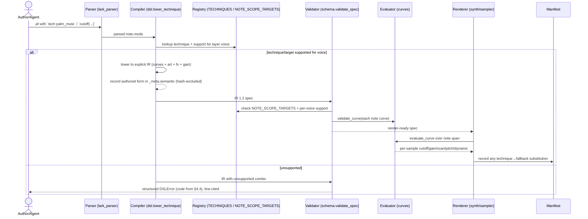

---
disclaimer:
  notice: >-
    No information within this document should be taken for granted.
    Any statement or premise not backed by a real logical definition
    or verifiable reference may be invalid, erroneous, or a hallucination.
  generated_by: "Claude Opus 4.8 (1M context) via Claude Code"
  date: "2026-06-12"
meta:
  title: "Expressive Performance Techniques & Note-Scope Timbre"
  type: "requirements-architecture"
  slug: "expressive-performance-techniques"
  status: "done"             # one of the Status Lifecycle values in §9; MUST match the filename suffix
  owner: "AudioForge maintainers"
  reviewers: ["AudioForge maintainers (operator-approved and implementation-accepted 2026-06-12)"]
  created: "2026-06-12"
  updated: "2026-06-12"
  scope_note: "D5 (instrument mechanics) moved INTO scope as R3 by operator mandate 2026-06-12; see §16."
  related_tasks: ["AF-P3", "G13"]
  related_documents:
    - "docs/DSL_GAP_SPEC.md (G13 entry — added in Phase 0; Engine 2.17.0 / DSL 1.11 reserved)"
    - "docs/IR_SCHEMA.md (IR 1.1 → 1.2 contract)"
    - "docs/DSL_SPEC.md (authoring surface)"
    - "static/refs/AF-P1-performance-curves-proposal-v2.1.md (G11 precedent this builds on)"
    - "static/refs/GOLDEN_FIXTURE_slash_style_solo.md (fixture discipline reference)"
  current_lifecycle_state: "done"
  validation_state: "validated"
---

# Requirements + Architecture — Expressive Performance Techniques & Note-Scope Timbre (AF-P3 / G13)

> ARCHITECTURAL REQUIREMENT (PALS's LAW): LLMs will always produce some form of error.
> Absence of output verification is a design defect, not a runtime bug.
> All LLM output MUST be treated as untrusted and validated explicitly.

---

## 0. How to read and update this document (meta-instructions)

This document is an **agent-executable contract**. It is written to be
**idempotent**: it remains correct whether read before any work starts, midway,
or after completion. Before acting, a reader MUST consult §10 (Task State
Ledger) to learn what is already done.

- A future agent **MUST** update the `meta.updated` date and the relevant rows of
  the §10 ledger in the same change that alters any tracked state.
- A future agent **MUST** change `meta.status`, `meta.current_lifecycle_state`,
  and the filename suffix together, following §9 (Status Lifecycle). The
  transitions and their triggers are defined there; no other status change is valid.
- A future agent **MUST NOT** delete historical decisions. Superseded content is
  moved to §16 (Decision Log) with a date and reason; it is never erased.
- A future agent **MUST NOT** redo work the §10 ledger marks `done-validated`
  unless the operator explicitly instructs rework (§9 `rework` transition).
- Keyword semantics throughout: **MUST** = mandatory, **MUST NOT** = forbidden,
  **SHOULD** = recommended, **NICE** = optional improvement. Vague terms
  ("properly", "cleanly", "robustly", "as needed") are forbidden unless defined
  on the spot.

---

## 1. Goal

### 1.1 What MUST be achieved

Add three first-class expressive capabilities to AudioForge, in dependency order:

- **R1 — Note-scope timbre curves.** A single note **MUST** be able to carry an
  explicit, hash-included curve on `cutoff_hz`, `gain_db`, or `scan`, evaluated
  over that note's own render span. Today note scope is hard-locked to
  `pitch_cents` and `dynamic` ([audioforge/schema.py:284](../audioforge/schema.py#L284)).
- **R2 — Technique registry.** A single source-of-truth registry of named
  playing techniques (e.g. `palm_mute`, `harmonic`, `dead_note`, `let_ring`,
  `accent`, `tenuto`, `staccatissimo`, `sul_ponticello`, `sul_tasto`). Each
  technique **SHOULD** be defined as a deterministic *lowering* to primitives
  that exist after R1 (articulation + fx + note-scope curves); a technique **MAY**
  require a new DSP kernel when necessary and viable under the DSP Kernel Policy
  (§8). No technique **MUST** introduce *renderer-private* behavior — any kernel
  it uses **MUST** be an explicit, documented, hash-owned primitive.
- **R3 — Instrument mechanics (string / fret / tuning / position).** A note
  **MUST** be able to declare the `string` and `fret` it is played on, and a
  fretted/stringed layer **MUST** be able to declare its `tuning` (ordered open
  pitches). `string`+`fret` **MUST** be authoritative: pitch is **derived** from
  tuning+fret (the ARC4D3 `TabNoteEvent` "resolvedPitch" pattern). `string`/`fret`
  **MUST** be first-class **hash-included** note IR fields (they are
  render-affecting and forward-compatible with future per-string sampling).
  Position→timbre **MUST** lower at compile time to an explicit R1 `cutoff_hz`
  note curve (documented constants), so the renderer stays data-driven.

A technique is a **named macro over R1 primitives**; R2 therefore depends on R1.
R3's position→timbre also lowers through R1. This mirrors the AF-P1 discipline:
smart authoring surface in the DSL, austere explicit data in the IR,
deterministic rendering from that data, one machinery.

### 1.2 Why it MUST be achieved (evidence)

AudioForge can shape *how loud, how high, and when* a note sounds, continuously
and per note, but cannot state *how a note is produced* or shape *timbre* on one
note. Verified deficiencies:

| ID | Deficiency | Evidence |
|---|---|---|
| **D1** | Technique vocabulary is a closed set of 8 articulations | `IR_ARTICULATIONS` = 7 ([schema.py:90](../audioforge/schema.py#L90)); DSL adds `trill` ([dsl.py:92](../audioforge/dsl.py#L92)); note_mod admits only `vel\|voicing\|art\|gen` ([lark_parser.py:70](../audioforge/lark_parser.py#L70)) |
| **D2** | Per-note continuous control is locked to pitch + dynamics; timbre is layer-only | note-scope `allowed_targets = PERFORMANCE_CURVE_TARGETS` ([schema.py:284](../audioforge/schema.py#L284)); `cutoff_hz`/`gain_db`/`scan` are layer-only `BASE_AUTOMATION_TARGETS` |
| **D3** (partial) | Per-note attack/length shaping is coarse; `env` is layer-only | `env` required at layer scope ([schema.py:455](../audioforge/schema.py#L455)) |
| **D5** | No instrument-mechanics dimension; same pitch on a different string is a different sound, unstateable | layer/note IR have no `string`/`fret`/`tuning`/`position` field (verified: not in `ir_json_schema()` `$defs.layer`/note item) |

R1 closes D2. R2 closes D1 and the bounded slice of D3 (accent/tenuto/staccatissimo).
R3 closes D5 for authoring + pitch resolution + synthetic position timbre (true
per-string *multisampling* is deferred — see §1.3).

### 1.3 Out of scope (MUST NOT be built in AF-P3)

> **Scope change (operator-mandated 2026-06-12):** D5 was moved **into** scope as
> R3. It is no longer a non-goal. What remains out of scope below is only the
> *unbounded* slice of D5, plus D4 and infrastructure items.

- **True per-string *multisampled* timbre.** R3 models string/fret/tuning and a
  *synthetic, documented* position→timbre lowering (via R1 on synth). Recording
  or onboarding a per-string, per-position multisample library is a **library
  onboarding** effort and **MUST NOT** be built here. On sampled voices, R3 is
  pitch-resolution + feasibility only (no per-string timbre — see §4.5).
- **Fingering optimization / automatic tab generation** (choosing string/fret
  for a given pitch). The author states string/fret; the compiler **MUST NOT**
  infer them.
- **D4 — general symbolic ornament engine** (turn, mordent, gruppetto).
  **MUST NOT** generalize `trill` here.
- **Per-note custom ADSR `env` objects.** **MUST NOT** add a note-level `env`.
- **Real-time / MPE input** and **learned technique generation.** These remain
  out of scope.

> **DSP kernels are NOT categorically out of scope.** A new DSP kernel **MAY** be
> built when it is *necessary and viable* under the **DSP Kernel Policy (§8)**.
> The bounded §4.3 technique set and R3's synthetic position→timbre happen to need
> no new kernel (they compose existing primitives), but a future technique that
> genuinely requires one is permitted, not rejected.

---

## 2. Requirements

Keyword semantics per §0. Each requirement is verifiable (see §7).

### 2.1 Functional (FR)

- **FR-1 (MUST)** Validation **MUST** accept note-scope curves with `target ∈ {pitch_cents, dynamic, cutoff_hz, gain_db, scan}` and `time_basis ∈ NOTE_TIME_BASES`.
- **FR-2 (MUST)** `scan` at note scope **MUST** be rejected unless the layer `osc` is `morph` (`scan_requires_morph_osc`).
- **FR-3 (MUST)** At most one curve per `(note, target)` for `cutoff_hz`/`gain_db`/`scan`; a duplicate **MUST** be rejected (`duplicate_note_timbre_curve`). `pitch_cents` retains its summing rule.
- **FR-4 (MUST)** A `TECHNIQUES` registry **MUST** exist as a single source. Each entry **MUST** declare params (with ranges), per-voice support, and a one-line normative lowering doc.
- **FR-5 (MUST)** Each technique **MUST** lower deterministically to explicit IR (articulation value, fx adjustments, and/or note-scope curves, and/or a dynamic/gain term). The renderer **MUST NOT** receive a "technique" concept.
- **FR-6 (MUST)** Authored technique name + params **MUST** be preserved under `_meta.semantic.authored_expression` (hash-excluded) and `decompile` **MUST** re-emit them.
- **FR-7 (MUST)** The DSL surface **MUST** support per-note `tech NAME` and `tech NAME(param=value, …)` and a per-layer technique default.
- **FR-8 (MUST)** A generic note-scope timbre-curve escape hatch **MUST** exist (`cutoff(...)`, `level(...)`, `scan(...)` note-mods) lowering to the matching `NOTE_SCOPE_TARGETS` curve.
- **FR-9 (MUST)** The capability manifest **MUST** publish `techniques`, `note_scope_targets`, params, ranges, and the per-voice support matrix.
- **FR-10 (MUST)** Unsupported `(technique × voice)` and `(target × voice)` combinations **MUST** fail validation with the named diagnostic that matches the manifest.
- **FR-11 (SHOULD)** The validator **SHOULD** emit an informational diagnostic when a layer-default technique is overridden per note.

R3 — instrument mechanics:

- **FR-12 (MUST)** A layer **MUST** be able to declare `tuning` as an ordered list of open pitches; a note **MUST** be able to declare integer `string` (1-based) and `fret` (`int ≥ 0` or `"x"` for muted). `string`/`fret` **MUST** be hash-included IR fields.
- **FR-13 (MUST)** When `string`+`fret` are present, the compiler **MUST** derive pitch deterministically as `open_pitch(string) + fret semitones` and use it as the note pitch. If `note`/`freq_hz` is *also* present and disagrees with the derived pitch, validation **MUST** reject with `string_fret_pitch_conflict`.
- **FR-14 (MUST)** Validation **MUST** reject `string` outside the layer `tuning` range (`string_out_of_tuning`), `fret` outside `[0, max_fret]` where `max_fret` defaults to 24 (`fret_out_of_range`), and `string`/`fret` without a layer `tuning` (`tuning_required_for_string_fret`).
- **FR-15 (MUST)** On **synth** voices, the compiler **MUST** lower position→timbre to an explicit R1 `cutoff_hz` note curve using documented constants (§4.5). On **sampled** and **physical-model** voices it **MUST NOT** emit a timbre curve (no per-voice filter); R3 there is pitch-resolution + feasibility only, recorded as a `position_timbre_unsupported` info diagnostic.
- **FR-16 (MUST)** Authored `string`/`fret`/`tuning` **MUST** round-trip through `decompile` (they are IR fields, not only provenance).

### 2.2 Non-functional (NFR)

- **NFR-1 (MUST)** Determinism: identical input **MUST** produce byte-identical IR and audio; no unseeded randomness, no wall-clock, no filesystem-order or platform-float dependence without a golden test.
- **NFR-2 (MUST)** Hash honesty: lowered curves/fx values **MUST** be hash-included; `_meta.semantic` provenance **MUST** be hash-excluded.
- **NFR-3 (MUST)** Backward compatibility: valid IR `1.1` specs **MUST** remain valid and render byte-identically under `1.2` (no migration required).
- **NFR-4 (MUST)** Performance: notes without timbre curves or techniques **MUST** stay on the existing fast path; the feature **MUST NOT** regress no-curve render throughput beyond 2% wall-clock on the existing render benchmark.
- **NFR-5 (SHOULD)** Lowering functions **SHOULD** be O(notes); no per-sample Python loops in the lowering layer.

### 2.3 Product (PR)

- **PR-1 (MUST)** Authoring a technique **MUST** require exactly one token per note (`tech NAME`), not a hand-built curve, for the §4.3 set.
- **PR-2 (MUST)** Every advertised technique **MUST** be demonstrable in the acceptance fixture (§9) and audible in a golden render once a supporting voice/library exists.
- **PR-3 (SHOULD)** Technique names **SHOULD** use the conventional musical term (`palm_mute`, `harmonic`), lowercase snake_case.
- **PR-4 (NICE)** A `NICE` future extension point: per-technique intensity (`accent(strength=…)`) already modeled; further techniques add registry rows only.

### 2.4 Engineering (ER)

- **ER-1 (MUST)** `NOTE_SCOPE_TARGETS` and `TECHNIQUES` **MUST** be defined once in runtime code and imported by docs/manifest/tests; duplication is forbidden.
- **ER-2 (MUST)** Reuse `audioforge.curves.validate_curve` / `evaluate_curve`. A second curve/automation subsystem **MUST NOT** be created.
- **ER-3 (MUST)** Lowering and validation **MUST** be pure functions; renderer integration may be optimized but the normative rule **MUST** remain independently testable.
- **ER-4 (MUST)** Grammar changes **MUST** land in all parser/EBNF/GBNF artifacts in a single commit (no parser-only landing).
- **ER-5 (MUST)** `docs/ir.schema.json` and `docs/capability.schema.json` **MUST** equal their runtime generators (drift tests).

### 2.5 Operational (OR)

- **OR-1 (MUST)** Every commit **MUST** leave the full gate green (`./scripts/run_tests.sh`).
- **OR-2 (MUST)** The commit that first emits lowered curves **MUST** be isolated and **MUST** name its hash transition in `docs/RELEASE_NOTES.md`.
- **OR-3 (MUST)** Render manifests **MUST** record any technique→fallback substitution (extend the existing `articulation_fallbacks` mechanism) so substitutions are observable, not silent.
- **OR-4 (SHOULD)** `validate` **SHOULD** report technique/target support problems as line-cited diagnostics (the existing render-ready resolve pass), not tracebacks.

### 2.6 AI-agent execution (AR)

- **AR-1 (MUST)** Before any edit, the agent **MUST** read §10 and act only on tasks not already `done-validated`.
- **AR-2 (MUST)** The agent **MUST** verify the Definition of Ready (§5) is fully satisfied before starting Phase 1.
- **AR-3 (MUST)** The agent **MUST** execute phases in the order in §3.7 and commit implementation + regression tests together.
- **AR-4 (MUST)** The agent **MUST** update the §10 ledger and `meta.updated` in the same change that alters state.
- **AR-5 (MUST NOT)** The agent **MUST NOT** widen scope to D4, to true per-string multisampling, or to fingering/tab inference. (D5 mechanics R3 is in scope per §1.1; only its unbounded slice in §1.3 is forbidden.) The agent **MAY** build a new DSP kernel when necessary and viable under the DSP Kernel Policy (§8) — kernels are not a scope violation.
- **AR-6 (MUST)** The agent **MUST** open a coordination task and re-check `git status` is quiet before each editing session (this repo has a concurrent committer — see §3.8 Failure Modes).

---

## 3. Architecture

### 3.1 Proposed architecture (summary)

Extend the existing G11 curve machinery. Add (a) a note-scope target allow-set
and (b) a technique registry whose entries are pure lowering functions emitting
G11-shaped IR. Renderers gain the ability to apply note-scope `cutoff_hz`,
`gain_db`, and `scan` curves; they learn nothing about "techniques".

### 3.2 Main components & responsibilities

| Component | File (existing/new) | Responsibility |
|---|---|---|
| `NOTE_SCOPE_TARGETS` | `audioforge/schema.py` (new constant) | Single source for which curve targets are legal at note scope |
| `TECHNIQUES` registry | `audioforge/schema.py` (new) | Single source of technique names, params, per-voice support, lowering doc |
| `lower_technique()` | `audioforge/dsl.py` (new, pure) | Compile a technique + params + layer context → explicit IR fragments |
| note-curve lowering | `audioforge/dsl.py` (extend) | Compile escape-hatch `cutoff()/level()/scan()` mods → `NOTE_SCOPE_TARGETS` curves |
| `tuning` model + string/fret resolver | `audioforge/dsl.py` + `audioforge/schema.py` (new, pure) | Derive pitch from `tuning`+`string`+`fret`; validate feasibility (R3) |
| position→timbre lowering | `audioforge/dsl.py` (new, pure) | On synth, emit an R1 `cutoff_hz` note curve from string/fret position (documented constants) |
| note-scope curve validation | `audioforge/schema.py` (`:284`) | Validate against `NOTE_SCOPE_TARGETS` + per-voice support + `scan`/`morph` rule |
| shared evaluator | `audioforge/curves.py` (REUSE) | `validate_curve`, `evaluate_curve` — unchanged |
| renderer | `audioforge/sequencer.py`, `sampler.py`, `synth.py` (extend) | Apply per-note `cutoff_hz`/`gain_db`/`scan` curves over the note span |
| capability manifest | `audioforge/capabilities.py` (extend) | Publish techniques + note-scope target support matrix |
| grammar | `audioforge/lark_parser.py` + EBNF/GBNF artifacts (extend) | Parse `tech NAME(params)` and escape-hatch curve mods |
| decompile | `audioforge/decompile.py` (extend) | Re-emit `tech NAME(params)` from `_meta.semantic` |

### 3.2.1 Architecture diagram



### 3.3 Data flow

DSL source → grammar parses `tech`/curve mods → compiler `lower_technique()` /
note-curve lowering → explicit IR (`note.curves[]`, `note.art`, layer `fx`,
`dynamic`/`gain_db`) → `validate_spec` (uses `NOTE_SCOPE_TARGETS`, support
matrix) → renderer evaluates curves via `evaluate_curve` and applies
filter/level/morph per note → audio + manifest (records any fallback). Authored
technique provenance flows in parallel to `_meta.semantic` (hash-excluded) and
is read back by `decompile`.

### 3.3.1 Sequence diagram — compile → validate → render



### 3.4 Integration points

- **G11 curves** (`audioforge.curves`): reused verbatim for note-scope timbre
  curves. AF-P3 adds targets, not a new evaluator.
- **Capability manifest**: the single contract agents read to plan; AF-P3 extends
  it additively.
- **Articulation/fallback machinery**: technique lowerings reuse articulation
  clamps and `articulation_fallbacks` manifest reporting.
- **Render plan (G12)**: technique lowering occurs before route selection; AF-P3
  does not change `routing`/plan semantics.

### 3.5 External dependencies

- The bounded §4.3 / R3 work needs **no new dependency** — NumPy, SciPy, and the
  existing curve evaluator and native kernels suffice.
- If future work needs a capability not already present, agents **MUST** prefer a
  proven library over hand-rolling (see DSP Kernel Policy, §8). A new dependency
  **MAY** be added only when it provides a needed, deterministic capability not
  available in-tree, with a pinned version and a determinism story; it **MUST NOT**
  be added frivolously.

### 3.6 Failure modes & recovery

| Failure mode | Detection | Required behavior |
|---|---|---|
| Technique unsupported for the layer's voice | validation, manifest lookup | Reject with `technique_unsupported_voice`; **MUST NOT** silently fall back |
| `scan` curve on non-`morph` osc | validation | Reject with `scan_requires_morph_osc` |
| Sampled instrument lacks a technique's articulation map | resolve pass | Apply documented articulation fallback **and** record it in manifest `articulation_fallbacks`; never silent |
| Note-scope curve target not in `NOTE_SCOPE_TARGETS` | validation | Reject with `note_curve_unsupported_target` |
| Technique param out of range | validation | Reject with `technique_param_out_of_range` |
| `string`/`fret` without layer `tuning` | validation | Reject with `tuning_required_for_string_fret` |
| `fret` or `string` out of range | validation | Reject with `fret_out_of_range` / `string_out_of_tuning` |
| `string`/`fret`-derived pitch disagrees with explicit `note`/`freq_hz` | validation | Reject with `string_fret_pitch_conflict` |
| Position timbre requested on sampled/physical voice | resolve pass | Skip the timbre curve; emit `position_timbre_unsupported` info; pitch + feasibility still resolve |
| Unknown note suffix token (pre-grammar-landing) | compiler | **Prerequisite:** raise a line-cited `DSLError`, never a raw traceback (see §13 open question OQ-1) |
| Concurrent committer mutates tree mid-edit | `git status` re-check | Abort the editing session, re-sync, re-open coordination task (§2.6 AR-6) |

### 3.7 Phase order (the only valid execution order)

P0 Preflight → P1 Schema/manifest/validation → P2 Pure lowering functions →
P3 Renderer integration → P4 DSL surface + decompile + drift → P5 Support matrix
& physical-model gating → P6 Docs/examples/release. Detailed per-phase tasks and
state are in §10.

R3 (instrument mechanics) threads through the same phases, not a separate track:
P1 adds the `string`/`fret`/`tuning` IR fields + feasibility validation + R3
diagnostics; P2 adds the pure string/fret→pitch resolver and the synth
position→timbre lowering; P4 adds the `string,fret` note-mod and layer `tuning`
authoring + decompile; P5 gates per-voice (synth timbre vs sampled
pitch-only). R3 emits no audio that R1's `cutoff_hz` path does not already
render, so it introduces no renderer risk beyond P3.

---

## 4. Detailed Contract

### 4.1 Note-scope timbre curve semantics (R1)

- `NOTE_SCOPE_TARGETS = PERFORMANCE_CURVE_TARGETS | {"cutoff_hz", "gain_db", "scan"}`.
- `cutoff_hz`: absolute Hz applied to the note voice filter over the note span.
- `gain_db`: additive dB on the note amplitude, summed with the `dynamic` level term.
- `scan`: wavetable morph `[0,1]`, legal only when layer `osc == morph`.
- Encoding/interpolation/edge behavior **MUST** be identical to G11 (`linear`
  default, `hold`, `pow:k` with k∈[0.1,10]; hold-before-first / hold-after-last;
  single point = constant).

**Per-voice support of note-scope targets (verified against the engine):**

| target | synth | sampled (instrument) | physical-model |
|---|---|---|---|
| `pitch_cents` | supported | supported (time-varying resampler, G11) | rejected (`curve_unsupported_voice`) |
| `dynamic` | supported | supported (velocity-layer crossfade) | supported |
| `gain_db` | supported | supported (amplitude) | supported |
| `cutoff_hz` | supported (synth has a voice lowpass) | **rejected** — the sampler has **no per-voice filter** (DSL_SPEC: "no filters/LFOs/CC … fx and automation own that ground"); use a layer `fx` filter instead | rejected |
| `scan` | supported **only** when `osc == morph` (synth) | **rejected** (no morph voice) | rejected |

This table is the authority for FR-1, FR-10, and the support matrix in the
manifest. `cutoff_hz`/`scan` at note scope are therefore effectively
**synth-only**; any sampled-voice use **MUST** be rejected with the matching
code in §4.4, not silently ignored.

### 4.2 Technique registry entry shape (R2)

```
technique_name -> {
  "lowers_to": ["<articulation>" | "fx:<name>" | "curve:<target>" | "dynamic" | "gain_db"],
  "params":    { name: {"type": "number"|"enum", "range"|"enum": ..., "default": ...} },
  "support":   {"synth": bool, "sampled": bool, "physical": bool},
  "doc":       "one-line normative lowering description",
}
```

### 4.3 Initial technique set (normative constants — pinned by golden tests)

| technique | params | lowering (documented constants) | support |
|---|---|---|---|
| `palm_mute` | — | synth: dur clamp ≤ 0.30 s + `cutoff_hz` hold @ 2500 Hz + `gain_db` −3 dB. sampled: dur clamp + `gain_db` −3 dB only (no voice filter) | synth (full); sampled (no darkening, manifest fallback) |
| `let_ring` | — | suppress dur clamp; +0.6 s amplitude release; overlap-safe | synth, sampled |
| `dead_note` | — | retain pitch, dur clamp 0.08 s, `gain_db` −6 dB; synth adds `cutoff_hz` hold low for the "thunk" (no `noise` osc exists — MUST NOT invent one) | synth (full); sampled (clamp+gain, manifest fallback) |
| `harmonic` | `partial∈{2,3,4}`=2 | transpose +12/+19/+24 st, bell envelope, `peak` emphasis | synth; sampled rejects w/o map (`technique_unsupported_voice`) |
| `accent` | `strength∈[0,1]`=0.5 | `dynamic` +0.10·strength, faster attack | synth, sampled |
| `tenuto` | — | full-length sustain + slight legato | synth, sampled |
| `staccatissimo` | — | dur clamp 0.06 s | synth, sampled |
| `sul_ponticello` | — | `cutoff_hz` hold high + `peak` brighten | **synth only** (needs voice filter) |
| `sul_tasto` | — | `cutoff_hz` hold low | **synth only** (needs voice filter) |

> Support consequence (from §4.1): techniques whose lowering uses `cutoff_hz`
> are full on synth and **either reduced (manifest-recorded fallback) or
> rejected** on sampled voices. The §10 P2 lowering tasks **MUST** encode both
> the synth and the sampled lowering for `palm_mute`/`dead_note`, and **MUST**
> reject `sul_ponticello`/`sul_tasto` on sampled voices.

### 4.4 Canonical diagnostic codes (single source — all other sections reference this)

Validation **MUST** emit exactly these codes; they **MUST** match the manifest
strings. Adding a code requires a row here plus a manifest entry plus a test.

| code | severity | raised when |
|---|---|---|
| `note_curve_unsupported_target` | error | a note-scope curve target ∉ `NOTE_SCOPE_TARGETS` |
| `note_curve_unsupported_voice` | error | a note-scope target is unsupported for the layer voice (see §4.1 table), e.g. `cutoff_hz`/`scan` on a sampled voice |
| `scan_requires_morph_osc` | error | a note-scope `scan` curve on a layer whose `osc != morph` |
| `duplicate_note_timbre_curve` | error | more than one `cutoff_hz`/`gain_db`/`scan` curve on the same note |
| `curve_unsupported_voice` | error | `pitch_cents` (or other) curve on a physical-model voice (existing G11 code; reused) |
| `technique_unknown` | error | `tech NAME` where `NAME ∉ TECHNIQUES` |
| `technique_unsupported_voice` | error | a technique unsupported for the layer voice (e.g. `harmonic` on a sampled instrument with no harmonic map; `sul_ponticello` on sampled) |
| `technique_param_out_of_range` | error | a technique param outside its declared range (e.g. `harmonic(partial=5)`) |
| `technique_layer_override` | info | a per-note `tech` overrides the layer-default technique (FR-11) |
| `technique_fallback` | info (manifest) | a technique lowered to a reduced form on the target voice (recorded in manifest, OR-3) |
| `tuning_required_for_string_fret` | error | a note has `string`/`fret` but the layer has no `tuning` (FR-14) |
| `string_out_of_tuning` | error | `string` index not present in the layer `tuning` (FR-14) |
| `fret_out_of_range` | error | `fret` outside `[0, max_fret]` (default 24) (FR-14) |
| `string_fret_pitch_conflict` | error | a `string`/`fret`-derived pitch disagrees with an explicit `note`/`freq_hz` (FR-13) |
| `position_timbre_unsupported` | info | position→timbre skipped on a sampled/physical voice (no per-voice filter) (FR-15) |

### 4.5 Instrument mechanics — string / fret / tuning / position (R3)

- **Fields (hash-included IR).** `layer.tuning`: ordered list of open pitches
  (e.g. `["E2","A2","D3","G3","B3","E4"]`), index 1 = first listed string.
  `note.string`: 1-based integer into `tuning`. `note.fret`: integer `≥ 0` or the
  string `"x"` (muted). These are **render data** (forward-compatible with future
  per-string sampling) and **MUST** be hash-included.
- **Pitch resolution (authoritative).** When `string`+`fret` are present, pitch
  **MUST** be derived: `midi = midi(open_pitch[string]) + fret`, then mapped to the
  note pitch. The derived pitch is the rendered pitch. `fret == "x"` lowers to the
  `dead_note` technique on that string's pitch.
- **Conflict rule.** If both `string`/`fret` and an explicit `note`/`freq_hz` are
  given, they **MUST** agree exactly or validation rejects
  (`string_fret_pitch_conflict`). Authoring **SHOULD** use one or the other.
- **Feasibility.** `string` **MUST** index a tuning entry; `fret` **MUST** be in
  `[0, max_fret]` (`max_fret` default 24, layer-overridable). Violations reject
  with the §4.4 codes.
- **Position→timbre (synth only, documented constants).** On synth voices the
  compiler **MUST** emit one R1 `cutoff_hz` note curve from string/fret position
  using these starting constants (pinned by golden test, ratified in P2):
  - base brightness rises with string pitch: `cutoff = 1500 Hz · 2^(open_semitones_above_low_E / 12)`, clamped `[1.5 kHz, 9 kHz]`;
  - fretting darkens slightly: `−40 Hz · fret`, floored at 1.2 kHz;
  - this is a **synthetic** timbre approximation, **not** a measured per-string model (see §1.3 / §15.2).
- **Per-voice support.** synth → pitch + feasibility + position timbre. sampled →
  pitch + feasibility only (no voice filter; emit `position_timbre_unsupported`).
  physical-model → pitch + feasibility only.
- **Provenance & decompile.** Because `string`/`fret`/`tuning` are IR fields,
  `decompile` re-emits them directly (FR-16); they are not duplicated into
  `_meta.semantic`.

---

## 5. Definition of Ready (DoR)

Implementation **MUST NOT** start until ALL are true. Blockers are explicit.

| # | Readiness | Category | Blocker if false |
|---|---|---|---|
| DoR-1 | This document is operator-approved; status = `approved` (satisfied 2026-06-12) | Product | Cannot start |
| DoR-2 | Reviewers assigned in `meta.reviewers` | Product | Cannot start |
| DoR-3 | DSL/Engine version targets chosen and reserved (not DSL 1.10) | Engineering | Cannot start P1 |
| DoR-4 | G11 dependency present on HEAD: `audioforge/curves.py`, `PERFORMANCE_CURVE_TARGETS`, note-scope curve validation | Dependency | Hard blocker |
| DoR-5 | G13 gap entry drafted in `docs/DSL_GAP_SPEC.md` | Design | Cannot start P1 |
| DoR-6 | Acceptance fixture (§9) coverage argument agreed | Validation | Cannot start P4 |
| DoR-7 | Open question OQ-1 (suffix-token hardening prerequisite) resolved or assigned | Engineering | Cannot start P4 |
| DoR-8 | Full gate green on HEAD before first change | Validation | Cannot attribute regressions |
| DoR-9 | Coordination task opened; tree quiet (concurrent committer) | Operational | Risk of collision |
| DoR-10 | R3 tuning model agreed (string numbering convention; `max_fret` default 24; position→timbre constants in §4.5 accepted or flagged for P2 ratification) | Design | Cannot start R3 in P1 |

---

## 6. Definition of Done (DoD)

Work is complete only when ALL are true. Every item is verifiable.

| # | Criterion | Verification |
|---|---|---|
| DoD-1 | IR `1.2` validates note-scope `cutoff_hz`/`gain_db`/`scan`; rejects bad target/voice and `scan` without `morph` | unit/contract tests pass |
| DoD-2 | `TECHNIQUES` registry is single-source; every §4.3 technique lowers to explicit IR via a pure function | compiler tests pass |
| DoD-3 | Manifest publishes techniques + note-scope targets + support matrix; manifest == runtime | drift tests pass |
| DoD-4 | Renderers consume note-scope timbre curves via the shared evaluator; no technique concept in renderer | renderer tests + code review |
| DoD-5 | `tech NAME(params)` and escape-hatch curves parse in all grammar artifacts (one commit); decompile round-trips | grammar + round-trip tests pass |
| DoD-6 | Hash changes iff lowered values change; unchanged iff only `_meta.semantic` changes | hash discipline tests pass |
| DoD-7 | Unsupported combos fail with the manifest-matching diagnostic | support-matrix tests pass |
| DoD-8 | Acceptance fixture compiles; lead-layer IR == checked-in golden snapshot; rejection fixtures fail with exact codes | acceptance tests pass |
| DoD-9 | NFR-4 throughput within +2% on the render benchmark | benchmark evidence in PR |
| DoD-10 | Docs/schema/grammar/manifest/examples/release notes synchronized | drift + docs review |
| DoD-11 | Full gate + coverage threshold pass; curve/lowering/validator/hash paths ≥ 95% | `./scripts/run_tests.sh` + coverage report |
| DoD-13 | R3: `string`+`fret`+`tuning` validate and resolve pitch authoritatively; feasibility + conflict rejections fire with §4.4 codes; synth position→timbre emits the §4.5 cutoff curve; sampled/physical emit `position_timbre_unsupported`; `decompile` round-trips the fields | unit + compiler + renderer + round-trip tests pass |
| DoD-12 | §10 ledger all `done-validated`; status = `done`; filename suffix updated | document review |

---

## 7. Tests

All tests **MUST** be deterministic, isolated, realistic; real
compiler/validator/renderer paths over mocks; no network; named
`test_<unit>_<scenario>_<expected>`.

### 7.1 Unit
- **MUST** test: note-scope curve schema accepts each new target; rejects layer
  time bases, duplicate timbre curve, `scan` without `morph`, out-of-range values.
  **Evidence:** assertions pass for accept and each reject path.
- **MUST** test: every `TECHNIQUES` entry has support flags, doc, and param ranges.
  **Evidence:** registry-shape test passes.

### 7.2 Integration (compiler)
- **MUST** test: each §4.3 technique lowers to its pinned explicit IR (golden
  constants); provenance recorded in `_meta.semantic` without changing the spec hash.
  **Evidence:** golden IR fragment equality + hash-equality before/after provenance.
- **MUST** test: escape-hatch `cutoff()/level()/scan()` lower to the matching curve.
  **Evidence:** target/points equality.

### 7.3 End-to-end (renderer)
- **MUST** test: a note-scope `cutoff_hz` curve sweeps the filter on one note,
  leaving the next note unaffected (deterministic golden render).
  **Evidence:** golden WAV hash + measured spectral-centroid delta on the swept note only.
- **MUST** test: `gain_db` sums with `dynamic`; `scan` morphs only the `morph`
  layer; no-curve notes stay on the fast path.
  **Evidence:** golden renders; fast-path assertion (no curve evaluation invoked).

### 7.4 Regression
- **MUST** test: all valid IR `1.1` fixtures render byte-identically under `1.2`
  (no-feature regression).
  **Evidence:** existing golden hashes unchanged on non-feature specs.

### 7.5 Contract / drift
- **MUST** test: `docs/ir.schema.json == ir_json_schema()`;
  `docs/capability.schema.json == runtime`; manifest techniques/targets ==
  runtime registry.
  **Evidence:** equality assertions pass.

### 7.6 Support matrix
- **MUST** test: physical-model voices reject unsupported techniques/targets with
  the manifest diagnostic; every advertised cell has a golden render.
  **Evidence:** one passing reject test per unsupported cell; one golden per supported cell.

### 7.7 Acceptance
- **MUST** test: `static/fixtures/expressive_techniques.af` compiles and its
  lead-layer IR equals the checked-in golden snapshot; sibling rejection fixtures
  fail with the exact diagnostic codes. The fixture **MUST** include an R3
  string/fret/tuning lead.
  **Evidence:** snapshot equality + expected-failure assertions.

### 7.8 R3 — instrument mechanics
- **MUST** test: `string`+`fret`+`tuning` resolves to the correct pitch for a
  known tuning (e.g. standard EADGBE), across open and fretted notes.
  **Evidence:** resolved pitch equals the expected note for a table of cases.
- **MUST** test: feasibility and conflict rejections fire —
  `tuning_required_for_string_fret`, `string_out_of_tuning`, `fret_out_of_range`,
  `string_fret_pitch_conflict` — each with a minimal failing spec.
  **Evidence:** one expected-failure assertion per code.
- **MUST** test: on synth, position→timbre emits the §4.5 `cutoff_hz` curve with
  the pinned constants; on sampled, no timbre curve is emitted and
  `position_timbre_unsupported` is reported.
  **Evidence:** curve points equality (synth); curve-absence + info diagnostic (sampled).
- **MUST** test: `decompile` of a resolved spec re-emits `string`/`fret`/`tuning`.
  **Evidence:** round-trip equality of the authored fields.

---

## 8. Coding Standards (binding for AI agents and humans)

- **Naming:** technique names lowercase snake_case; constants UPPER_SNAKE;
  diagnostic codes lowercase snake_case matching the manifest; tests
  `test_<unit>_<scenario>_<expected>`.
- **File organization:** new constants/registries in `schema.py`; pure lowering
  in `dsl.py`; evaluator stays in `curves.py`; renderer code in
  `sequencer.py`/`sampler.py`/`synth.py`. **MUST NOT** create a new module for a
  second curve system.
- **Typing:** Python type hints on all new public functions; structured
  return types (dict fragments) documented at the function.
- **Error handling:** typed `DSLError`/`SpecError`/`CurveError` with line/path
  citation; **MUST NOT** raise raw exceptions on user input; **MUST NOT** use
  bare `except`.
- **Logging/diagnostics:** user-facing problems are structured `Diagnostic`s or
  raised typed errors with paths; **MUST NOT** `print`.
- **Configuration:** no new config; behavior is data in the registry, not flags.
- **Security:** no `eval`/`exec`/dynamic import of technique names; the registry
  is a closed set validated against the manifest.
- **Maintainability:** comments **MUST** be sparse and normative (DSP law, hash
  policy, lowering constants); adding a technique = registry row + lowering +
  tests, nothing else.
- **DSP Kernel Policy:** A new DSP kernel **SHOULD** be built when it is
  (a) *necessary* — a required behavior cannot be achieved by composing existing
  primitives/libraries — and (b) *viable* — implementable deterministically,
  golden-testable, and hash-ownable. Agents **MUST** prefer a proven library
  (NumPy, SciPy, in-tree kernels) and **MUST NOT** reinvent a capability a proven,
  already-available library provides. A new kernel **MUST** follow the existing
  native-kernel discipline: a documented, hash-owned renderer primitive that
  **fails loudly** when unavailable (no silent fallback that alters audio) and is
  covered by a golden/conformance test. Building a kernel that is **not** necessary
  is overengineering and is forbidden; **equally forbidden** is refusing a kernel
  that *is* necessary and viable and faking the behavior with an inadequate lowering.
- **Anti-overengineering:** **MUST NOT** add abstraction layers, plugin hooks, or
  speculative kernels. Build only what a requirement needs — but when a
  requirement genuinely needs a kernel, build it (per the DSP Kernel Policy), do
  not fake it.
- **No undocumented assumptions:** every assumption goes in §12; every open
  question in §13; every dependency in §3.4–§3.5.

---

## 9. Status Lifecycle

### 9.1 Valid status values

`draft`, `approved`, `in-progress`, `in-review`, `validated`, `done`, `rejected`,
`rework`, `superseded`.

`approved` is the operator-acceptance state (scope accepted; implementation may
begin once the full DoR §5 is met). It is the canonical name; the earlier draft
used `ready` for this role — treat any `ready` as a synonym for `approved`.

### 9.2 State diagram

```mermaid
stateDiagram-v2
  [*] --> draft
  draft --> approved: operator approves scope + reviewers assigned (DoR-1,2)
  approved --> in_progress: agent satisfies full DoR (§5) and opens coordination task
  in_progress --> in_review: all §10 phases done-unvalidated; PR opened
  in_review --> validated: reviewers confirm DoD §6 verifications pass
  validated --> done: operator accepts; status+filename updated
  in_review --> rework: reviewer rejects a DoD item
  rework --> in_progress: agent addresses rework with operator authorization
  draft --> rejected: operator declines the goal
  validated --> superseded: replaced by a newer doc (§16)
  done --> superseded: replaced by a newer doc (§16)
  done --> [*]
  rejected --> [*]
  superseded --> [*]
```



> `superseded` is reachable from **any** state when a newer document replaces this
> one (the diagram shows the common cases); the operator triggers it and **MUST**
> add the replacement link to §16.

### 9.3 Transition table

| From → To | Trigger (who) | Validation required before transition | Invalid handling |
|---|---|---|---|
| draft → approved | Operator | DoR-1, DoR-2 true | If DoR-3..10 unknown, stay `draft`; scope changes after approval are recorded in §16 and **MUST NOT** silently alter an approved doc |
| approved → in-progress | Agent | Full DoR (§5, incl. DoR-10) verified; coordination task open | If any DoR false, **MUST** stay `approved` and list the blocker |
| in-progress → in-review | Agent | §10 phases all `done-unvalidated`; gate green | If a phase incomplete, stay `in-progress` |
| in-review → validated | Reviewers | All DoD (§6) verifications pass | If any fails → `rework` |
| validated → done | Operator | Acceptance (DoD-12); filename suffix updated | If acceptance withheld, stay `validated` |
| in-review → rework | Reviewer | A DoD item fails | Record the failing item in §10 |
| rework → in-progress | Agent (operator-authorized) | Operator explicitly authorizes rework | **MUST NOT** rework without authorization |
| any → superseded | Operator | A replacement doc exists; link added to §16 | — |
| draft → rejected | Operator | — | — |

Any transition not in this table is **invalid** and **MUST** be refused; the
agent **MUST** leave status unchanged and surface the reason.

### 9.4 Idempotent reading

This document is correct regardless of progress. A reader **MUST** derive "what
to do next" from §10, not from prose tense. If §10 shows all phases
`done-validated` and status `done`, the reader **MUST NOT** re-execute any phase.

---

## 10. Task State Ledger (idempotency control)

State values: `not-started`, `in-progress`, `done-unvalidated`,
`done-validated`, `rejected`. An agent **MUST** read this table before acting,
**MUST** act only on rows that are not `done-validated`, and **MUST** update the
row + `meta.updated` in the same change.

| Phase | Task | State | Validated by | Notes |
|---|---|---|---|---|
| P0 | Confirm/reserve versions; add G13 gap entry; confirm G11 present | `done-validated` | `docs/DSL_GAP_SPEC.md` G13 entry; `audioforge/version.py`; G11 files/tests present; `./scripts/run_tests.sh` | Reserved Engine 2.17.0 / DSL 1.11; current runtime remains Engine 2.16.0 / DSL 1.9 |
| P1 | `NOTE_SCOPE_TARGETS`, `TECHNIQUES` skeleton, diagnostics, manifest+schema regen (hash-inert) | `done-validated` | `tests/test_expressive_techniques_schema.py`; `tests/test_manifest_registry_coverage.py`; `tests/test_ir_schema.py`; `./scripts/run_tests.sh` | No-feature render suites stayed byte-identical |
| P2 | Pure `lower_technique()` + escape-hatch lowering; golden constants | `done-validated` | `tests/test_expressive_techniques_lowering.py`; `./scripts/run_tests.sh` | Lowering stays compiler-side; renderer consumption remains P3 |
| P3 | Renderer applies note-scope cutoff/gain/scan (HASH MOVE — isolate) | `done-validated` | `tests/test_performance_curves_render.py`; adjacent curve/schema/lowering tests | Synth applies `cutoff_hz`, `gain_db`, and `scan`; sampled applies supported `gain_db` only |
| P4 | Grammar `tech`/curve mods (all artifacts, one commit) + decompile + drift | `done-validated` | `tests/test_ai_agent_dsl.py`; `tests/test_grammar_token_sync.py`; adjacent schema/lowering/docs tests | DSL accepts `tech`, curve escape hatches, `tuning`, `string`, `fret`; decompile round-trips authored surface |
| P5 | Support-matrix gating; physical-model rejections; per-cell goldens | `done-validated` | `tests/test_expressive_techniques_schema.py`; `tests/test_expressive_techniques_lowering.py` | Per-cell synth/sampled/physical curve and technique gates pinned |
| P6 | Docs/examples/release notes; acceptance + rejection fixtures | `done-validated` | `tests/test_expressive_techniques_acceptance.py`; `static/fixtures/expressive_techniques.af`; `static/fixtures/rejections/expressive_*.af`; focused AF-P3/G13 gate; `./scripts/run_tests.sh` | Acceptance fixture compiles to the checked golden IR snapshot; rejection fixtures fail with canonical diagnostic codes |
| P1·R3 | `string`/`fret`/`tuning` IR fields + feasibility/conflict validation + R3 diagnostics | `done-validated` | `tests/test_expressive_techniques_schema.py`; `docs/ir.schema.json` | hash-included fields; pure pitch/timbre lowering remains P2·R3 |
| P2·R3 | Pure string/fret→pitch resolver + synth position→timbre cutoff lowering (§4.5 constants) | `done-validated` | `tests/test_expressive_techniques_lowering.py`; `./scripts/run_tests.sh` | Golden constants pinned for E2 open and A2 fret 5 |
| P4·R3 | `string,fret` note-mod + layer `tuning` authoring + decompile round-trip | `done-validated` | `tests/test_ai_agent_dsl.py`; focused AF-P3/G13 gate | Grammar/decompile round-trip covers layer `tuning`, `max_fret`, note `string`, and note `fret N|x` |

> Initial state: nothing started. When work begins, the executing agent updates
> the relevant row(s) only. Completed-and-validated rows **MUST NOT** be redone.

---

## 11. AI-Agent Instructions (operational)

- The agent **MUST** use the keyword semantics in §0 and treat every **MUST** as
  a hard gate.
- The agent **MUST** verify DoR (§5) before Phase 1 and DoD (§6) before
  declaring done; both are checklists, not prose.
- The agent **MUST** check §10 before acting and **MUST NOT** redo
  `done-validated` work unless §9 `rework` is operator-authorized.
- The agent **MUST** execute phases in §3.7 order, commit code + tests together
  (Conventional Commits), and keep the gate green at every commit (OR-1).
- The agent **MUST** re-check `git status` is quiet before each editing session
  (AR-6) and abort on a concurrent change.
- The agent **MUST NOT** widen scope (D4, true per-string multisampling,
  fingering/tab inference) or invent diagnostics, versions, or library/instrument
  names. (D5 mechanics R3 is in scope; see §1.1/§1.3.) New DSP kernels are allowed
  under the DSP Kernel Policy (§8), not a scope violation.
- The agent **MUST** record new assumptions in §12, new open questions in §13,
  and superseded decisions in §16.
- All explicit assumptions, open questions, and dependencies are in §12, §13, and
  §3.4–§3.5 respectively; the agent **MUST** keep them current.

---

## 12. Assumptions (explicit)

- **A-1** G11 (AF-P1) is landed on HEAD and stable (verified 2026-06-12: commit
  `feat: implement AF-P1 performance curves`).
- **A-2** The renderer can apply a per-note filter/level/morph curve using the
  same evaluator used for `pitch_cents`/`dynamic` without a new DSP kernel.
- **A-3** Sampled instruments without a technique's articulation map are an
  acceptable documented-fallback case (manifest-recorded), not a hard reject,
  except `harmonic` which rejects without a map.
- **A-4** DSL 1.10 is reserved by the G11 curve-sugar surface; AF-P3/G13 is
  reserved for Engine 2.17.0 / DSL 1.11 while the current runtime remains Engine
  2.16.0 / DSL 1.9.

## 13. Open Questions (explicit)

- **OQ-1** Resolved 2026-06-12: unknown-note-suffix and malformed note-modifier
  inputs now raise line-cited `DSLError` diagnostics instead of the observed
  `TypeError: 'Tok' object is not iterable`. Validated by
  `tests/test_ai_agent_dsl.py`.
- **OQ-2** Is `let_ring`'s +0.6 s release a global constant or per-voice? Default
  to global until a golden shows audible inadequacy.
- **OQ-3** Should `accent.strength` reuse the `dynamic` mark scale or a raw
  multiplier? Proposal: raw additive on `[0,1]` dynamic.

## 14. Dependencies (explicit)

- **Runtime:** none new. NumPy + `audioforge.curves` (present).
- **Internal:** G11 curve machinery (hard); capability manifest; articulation
  fallback reporting; grammar artifacts.
- **Process:** operator approval (DoR-1), reviewer assignment (DoR-2),
  coordination with the concurrent committer (AR-6).

---

## 15. Risks, Trade-offs, Alternatives, Rollout, Observability, Validation Evidence

### 15.1 Risks
- **R-1 (high)** Renderer per-note timbre application (P3) is the riskiest change
  and moves hashes. Mitigation: isolate the commit; golden renders gate it.
- **R-2 (medium)** Concurrent committer mutates the tree mid-work. Mitigation: AR-6.
- **R-3 (medium)** Technique constants are subjective. Mitigation: pin by golden;
  treat changes as audio-semantic changes (RELEASE_NOTES + hash update).

### 15.2 Trade-offs
- Techniques as macros over primitives (chosen) keep the renderer simple and the
  IR explicit.
- **R3 (D5) is in scope, but its render-timbre is *synthetic*.** `string`/`fret`/
  `tuning` are modeled as first-class IR with authoritative pitch resolution and a
  documented synth position→timbre lowering (§4.5). The trade is that string
  *color* is approximated, not measured: true per-string multisampled realism
  needs a recorded library and is deferred to library onboarding (§1.3). The IR
  fields are chosen so that future per-string sampling reads them without a
  schema change.

### 15.3 Alternatives considered
- **Alt-1: per-note `env` object** — rejected (NFR/scope creep; D3 is covered by
  attack/length techniques).
- **Alt-2: renderer-native techniques** — rejected (violates "runtime consumes
  data"; hides render-affecting behavior from the IR/hash).
- **Alt-3: extend `ARTICULATIONS` only (no curves)** — rejected (cannot express
  continuous timbre, D2 unaddressed).
- **Alt-4 (R3): `string`/`fret` as `_meta` provenance only** — rejected: string
  choice is render-affecting and must survive into a future per-string sampler,
  so the fields are hash-included IR, not provenance.
- **Alt-5 (R3): full per-string multisampled timbre now** — rejected for this
  goal (unbounded; needs a recorded library); deferred to library onboarding.

### 15.4 Rollout
Additive IR `1.2`; valid `1.1` specs unaffected (NFR-3). Feature is opt-in per
note/layer. Land per §3.7; the single hash-moving commit (P3) is named in
RELEASE_NOTES.

### 15.5 Observability
`validate` reports support problems as line-cited diagnostics; render manifests
record technique→fallback substitutions (OR-3); the capability manifest is the
machine-readable support contract.

### 15.6 Validation evidence (to be filled as phases complete)
- P0: Added the G13 gap entry, reserved Engine 2.17.0 / DSL 1.11, confirmed the
  current runtime remains Engine 2.16.0 / DSL 1.9, regenerated stale ignored
  library catalog snapshots required by the local gate, and ran
  `./scripts/run_tests.sh` successfully (`441 passed, 2 skipped`, 2026-06-12).
- P1: Added `NOTE_SCOPE_TARGETS`, `TECHNIQUES`, canonical diagnostics, manifest
  publication, IR schema 1.2 fields, generated schema artifacts, and R3
  feasibility/conflict validation. Focused tests passed (`38 passed`; nearby
  schema/curve/docs tests `32 passed`) and `./scripts/run_tests.sh` passed
  (`458 passed, 2 skipped`, 2026-06-12). Existing no-feature render suites
  remained byte-identical.
- P2: Added pure compiler lowering for all registered techniques, note-scope
  `cutoff_hz`/`gain_db`/`scan` escape hatches, layer default technique handling,
  sampled fallback diagnostics, string/fret pitch resolution, muted-string
  dead-note lowering, and synth-only position-to-timbre cutoff lowering. Focused
  tests passed (`30 passed`) and the full gate passed
  (`474 passed, 2 skipped`, 2026-06-12).
- P3: Added renderer consumption for note-scope timbre curves. Synth note
  rendering now applies absolute `cutoff_hz` lowpass envelopes, additive
  `gain_db` envelopes, and per-note morph `scan` envelopes through the existing
  curve evaluator; sampled instrument rendering applies supported note
  `gain_db` envelopes while validation continues to reject sampled
  `cutoff_hz`/`scan`. Focused renderer tests passed (`6 passed`) and adjacent
  curve/schema/lowering tests passed (`70 passed`); the full gate passed
  (`478 passed, 2 skipped`, 2026-06-12).
- P4 prerequisite: Hardened malformed `notes:` parsing so unknown note suffixes
  and unsupported note modifiers raise line-cited `DSLError` diagnostics instead
  of leaking raw token errors. Focused DSL tests passed (`20 passed`,
  2026-06-12).
- P4: Added executable grammar support for `tech NAME(k=v)`, `cutoff(Nhz)`,
  `level(Ndb)`, `scan(N)`, `string N`, `fret N|x`, layer `tuning`, and
  `max_fret`; decompile preserves authored technique/mechanics modifiers and
  suppresses their lowered curves on round-trip. Fixed position-timbre lowering
  precedence so explicit/tech cutoff curves prevent duplicate derived cutoff.
  Focused P4/P2/P1 regression set passed (`62 passed`, 2026-06-12).
- P5: Added per-cell support-matrix regressions for sampled and physical-model
  note-scope curves plus technique support, fallback, and rejection cells.
  Focused expressive schema/lowering tests passed (`56 passed`, 2026-06-12).
- P6: Added `static/fixtures/expressive_techniques.af`, rejection fixtures for
  `scan_requires_morph_osc`, `duplicate_note_timbre_curve`, and
  `curve_unsupported_voice`, and golden IR snapshot acceptance coverage.
  Added a no-curve renderer fast-path regression proving synth and sampled
  renders do not invoke curve evaluation when no note curves are present.
  Focused AF-P3/G13 regression gate passed (`117 passed`, 2026-06-12), and
  `./scripts/run_tests.sh` passed (`511 passed, 2 skipped, 6 warnings`,
  2026-06-12).

---

## 16. Decision Log (historical — never delete)

- **2026-06-12** — Document created from the verified deficiency analysis
  (D1–D5). Scope fixed to R1+R2 (D1/D2, partial D3); D4/D5 declared non-goals.
  Supersedes the earlier ad-hoc note `docs/goal-AF-P3-expressive-techniques.md`
  (removed; content folded here).
- **2026-06-12 (refine pass 2)** — Corrected against the engine: (a) the sampler
  has **no per-voice filter**, so `cutoff_hz`/`scan` note curves and the
  cutoff-based techniques (`palm_mute`, `sul_ponticello`, `sul_tasto`) are
  synth-only — added the §4.1 per-voice support table and revised the §4.3
  support columns; (b) removed the fabricated "noise voice" from `dead_note`
  (no `noise` osc exists) and re-lowered it to clamp + `gain_db` + synth
  `cutoff_hz`; (c) added the §3.2.1 architecture diagram and §3.3.1 sequence
  diagram (the first draft had only the §9.2 state diagram); (d) added the §4.4
  canonical diagnostic-code table as the single source; (e) fixed Decision-Log
  cross-references (§16, previously mis-numbered §15) and the invalid Mermaid
  `any` pseudo-state. Validation state remains `unvalidated` (plan only).
- **2026-06-12 (operator approval)** — Operator approved the document
  (`draft → approved`); filename suffix set to `-approved`. `meta.reviewers` set
  to "AudioForge maintainers" (owner==reviewer; a distinct reviewer SHOULD be
  named before `approved → in-progress`). Added `approved` to the §9 lifecycle as
  the operator-acceptance state (canonical name; `ready` retained as a synonym).
- **2026-06-12 (operator scope change)** — Operator mandated **D5 (instrument
  mechanics) INTO scope**, overriding its prior non-goal status. Added as **R3**:
  first-class hash-included `string`/`fret`/`tuning` IR fields, authoritative
  pitch resolution, feasibility/conflict validation (new §4.4 codes), and a
  synth-only synthetic position→timbre lowering via R1 (§4.5). Threaded through
  P1/P2/P4 (§10). Out-of-scope narrowed to only the *unbounded* slice: true
  per-string multisampling and fingering/tab inference (§1.3). This is a scope
  change to an already-approved doc; recorded here per §9.3.
- **2026-06-12 (operator correction — DSP kernels)** — Removed the blanket
  "no new DSP kernels" prohibition (it contradicted AudioForge's own native-kernel
  architecture). Replaced with the **DSP Kernel Policy (§8)**: build a kernel when
  *necessary and viable*, prefer proven libraries (NumPy/SciPy/in-tree), never
  reinvent what a proven lib provides, never fake a needed behavior with an
  inadequate lowering; any kernel is a documented, hash-owned, fail-loud primitive.
  Updated §1.1 (R2), §1.3, §3.5, §8, AR-5, and §11 accordingly.
- **2026-06-12 (P0 gap reservation)** — Added G13 to
  `docs/DSL_GAP_SPEC.md`, confirmed the current runtime source remains Engine
  2.16.0 / DSL 1.9, and reserved AF-P3/G13 for Engine 2.17.0 / DSL 1.11 because
  DSL 1.10 is already reserved for G11 curve sugar. Assigned OQ-1 to a standalone
  prerequisite before P4.
- **2026-06-12 (implementation accepted)** — AF-P3/G13 reached DoD-12:
  all §10 ledger rows are `done-validated`, validation evidence includes the
  focused AF-P3/G13 gate and `./scripts/run_tests.sh`, and the lifecycle moved
  to `done` with the filename suffix updated from `-approved` to `-done`.
  A post-closure focused regression pass included the no-curve renderer
  fast-path guard (`117 passed`).
